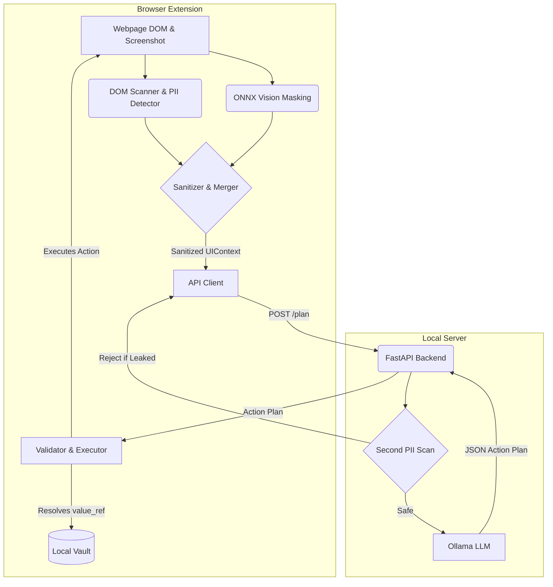

# PrivacyGuard: Local-First Privacy Firewall for AI Browser Agents

## The Problem
**On-device Visual Perception for Lightweight Browser Agents**
AI browser agents often need to "see" what the user sees to automate tasks or answer questions. However, blindly sending raw DOM data and screenshots to an external LLM presents a massive privacy risk. Passwords, emails, credit cards, and sensitive account details can be leaked, and prompt injections embedded in the webpage could hijack the agent.

## The Solution
PrivacyGuard is a local-first browser extension (Chrome MV3) that acts as a privacy firewall. It uses a cascading pipeline of DOM analysis, local heuristics, and lightweight vision models (via ONNX WebGPU/WASM) to detect and redact Personally Identifiable Information (PII) entirely *within the browser* before any data is sent to an LLM.

The LLM (running locally via Ollama) only receives a sanitized `UIContext` containing abstract `pg-id` references. When the LLM requests an action requiring a secret (e.g. typing a password), it returns a `value_ref`, which the extension safely resolves locally from a secure vault. 

## Features
- **Zero-Data-Leak Architecture**: Raw PII and screenshots never leave the extension.
- **Hybrid Perception**: Combines DOM scanning with local vision-based element detection.
- **Reference-Based Actions**: The LLM uses stable `pg-id` references and `value_ref` secret pointers.
- **Strict Validator**: Only allows safe actions (`click`, `type`, `scroll`, `select`, `navigate`, `wait`).
- **Prompt Injection Defense**: Untrusted page text is delimited and stripped of active commands.
- **Metrics Dashboard**: Built-in latency tracking and security audit logging.

## Tech Stack
- **Extension**: TypeScript, React, Vite, Tailwind, Chrome MV3.
- **Vision**: DOM-only (no model bundled). *Note: The architecture supports ONNX WebGPU/WASM, but for this prototype, the vision model weights are omitted to keep the extension lightweight.*
- **Backend/LLM Engine**: FastAPI, Pydantic, Python 3.10+, Ollama.

## Architecture



## Setup & Installation

### 1. Prerequisites
- Node.js (v18+)
- Python 3.10+
- [Ollama](https://ollama.com) installed and running.

### 2. Model Setup
Pull a lightweight model for Ollama (e.g., `qwen2.5:3b-instruct` or `llama3.2:3b`):
```bash
ollama pull qwen2.5:3b-instruct
```

### 3. Backend (FastAPI) Setup
**Windows:**
```powershell
cd server
python -m venv venv
.\venv\Scripts\Activate.ps1
pip install -r requirements.txt
uvicorn app.main:app --reload
```
**Linux / macOS:**
```bash
cd server
python3 -m venv venv
source venv/bin/activate
pip install -r requirements.txt
uvicorn app.main:app --reload
```

### 4. Extension Setup
```bash
cd extension
npm install
npm run build
```
Load into Chrome:
1. Go to `chrome://extensions/`
2. Enable **Developer mode**.
3. Click **Load unpacked** and select the `extension/dist` folder.

## Evaluation & Benchmarking
Run the evaluation harness to generate performance metrics:
```bash
cd extension
npx tsx eval/run_eval.ts
```
*(This writes results to `eval/results.json` and copies it for the dashboard.)*

### Metrics Collected
- **PII F1 Score**: Accuracy of detecting emails, phones, and cards.
- **Latency**: Median and p95 timings across DOM scanning, sanitization, and LLM planning.
- **Resource Usage**: Estimated RAM and CPU overhead.

## Demo Walkthrough
1. **Start the demo site:**
   ```bash
   cd demo-site
   npx serve .
   ```
2. **Open the App:** Navigate to `http://localhost:3000/application.html`.
3. **Popup Overview:** Click the PrivacyGuard icon. View the summary of detected PII.
4. **Context Tab:** Check the JSON tab to verify that `secret@private.com` has been replaced with `[EMAIL]`.
5. **Vision Tab:** See the side-by-side "Original" vs "Masked" screenshot. Note the "NEVER SENT" label on the original.
6. **Agent Tab:** Enter "Submit the application" and click **Start Agent**.
7. **Execution:** Watch the extension plan actions, resolve local secrets, and navigate the form.
8. **Dashboard:** Open the Dashboard to view the exact Latency metrics and Security Audit Log.

## Privacy Architecture & Security
- **Local Vault**: Secrets (`user_email`, `password`) are stored in `chrome.storage.local`.
- **Double Filtering**: The extension sanitizes outgoing context. The FastAPI backend runs a secondary scan on incoming payloads to catch any leaks the frontend missed.
- **Origin Allowance**: Navigations are restricted by default to prevent the agent from being hijacked to external sites.

## Limitations
- Complex SPAs with massive DOM trees can slow down the initial scanning phase.
- The WebGPU vision model relies on browser hardware support; it falls back to WASM which takes longer.
- Luhn validation is only strictly applied on the server to prevent the frontend from slowing down.

## Future Work
- Integrating more advanced local ONNX models for semantic text classification (detecting addresses or sensitive medical text).
- Porting to Firefox MV3.
- Implementing an automatic prompt-injection honeypot within the extension.
